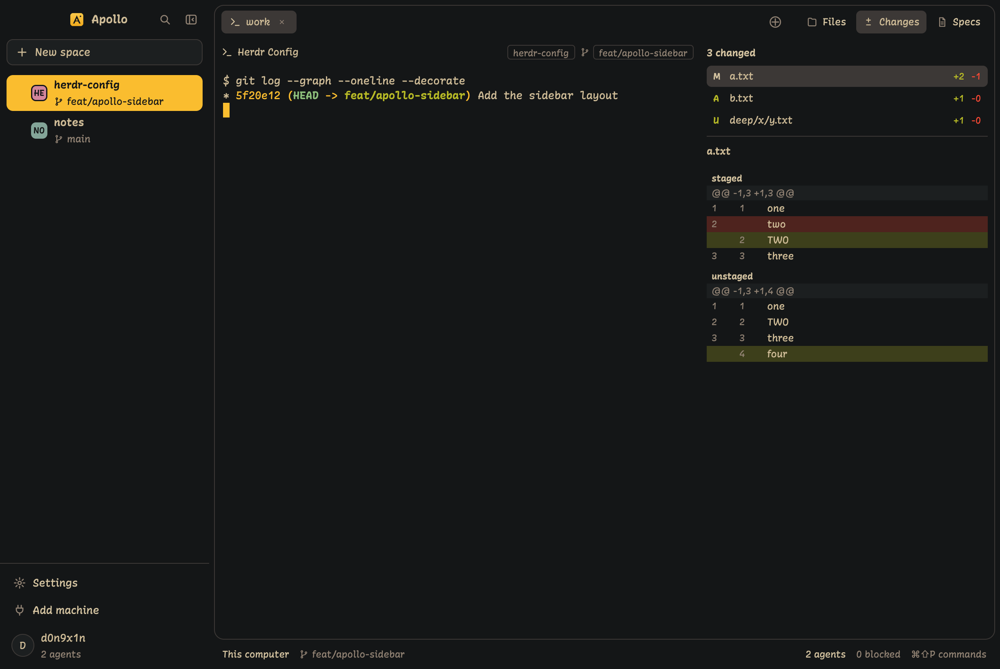

<div align="center">

# Apollo

**Yet, just another Herdr layout, made for working with coding agents.**

An original Herdr layout with Apollo colors and a SonicTerm-aligned macOS keymap.

[](https://github.com/D0n9X1n/herdr-config/actions/workflows/ci.yml)
[](https://github.com/D0n9X1n/herdr-config/tags)
[](LICENSE)

[Documentation](wiki/Home.md) · [简体中文文档](wiki/Home-zh-CN.md)

</div>

<p align="center">
  
</p>

<p align="center">
  <b>The Changes panel on a demo repo: one file with staged and unstaged parts.</b>
</p>

## Highlights

- **Spaces and agents** in a sidebar with branches and status marks. It collapses to 184 px and keeps the names. See [Sidebar](wiki/Sidebar.md).
- **Changes and Specs panels**: diffs with staged and unstaged groups, and your repo's specs with a "Work on it" button. See [Panels](wiki/Panels.md).
- **A SonicTerm keymap** for macOS and one for Windows, plus window buttons on Windows. See [Keys](wiki/Keys.md) and [Install](wiki/Install.md).
- **Agent context**: a hook script tells Claude Code or Copilot CLI that they run in Herdr. See [Agent Context](wiki/Agent-Context.md).
- **Apollo app icon** for the Dock: `scripts/set-app-icon.sh`. See [Install](wiki/Install.md).

## Install

```sh
H=~/.config/herdr-app
cp layouts/apollo.json layouts/apollo.svg "$H/layouts/"
cp themes/apollo.json "$H/themes/"
cp -R mods/apollo-* "$H/mods/"
herdr-app do layout.switch '{"name":"apollo"}'
```

Use copies, not links. See [Install](wiki/Install.md) for why, and for the keymap.

## License

MIT. See [LICENSE](LICENSE).
