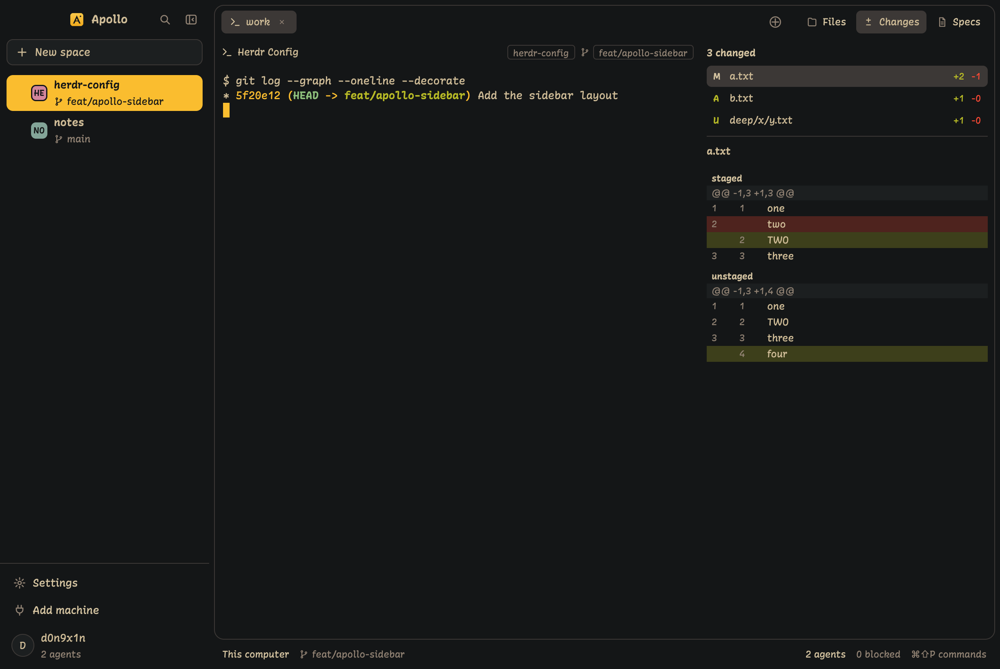

# Apollo

A dark Herdr layout in the Apollo colors. On the left, a sidebar lists your spaces with their branch and their agents. On the right, a rounded work card holds the tab row, the panes (each with a header) and an optional side panel for Files, Changes or Specs. A thin status bar sits under the card.

## What you see

Left to right:

- **Sidebar**, 256 px wide (184–480), on `chrome` `#141617`:
  - **Brand row**, 48 px, draggable. The native traffic lights at `[12, 16]`; nothing is drawn in x 12–70, y 10–30. Then the Apollo logo (`mods/apollo-chrome/logo.png`, 20 px, radius 5) and "Apollo" in 14 px semibold `foreground` `#cfbc97`. On the right, `search` and `panel-close`, 28×28 each.
  - **Spaces block**, 8 px side padding. A full-width "New space" button (32 px, radius 8, `raised` `#1c1f20`, 1 px `border` `#3c3836`). Then one 44 px row per space: a fold chevron (only when the space has agents), a 20×20 two-letter tile in `ansi4`, `ansi5` or `ansi6`, the name (13 px semibold) over a 12 px `branch` glyph and branch name (12 px `dim` `#928374`), and a 12 px status mark on the right. Under an unfolded space, 28 px agent rows: program icon (14), title (12 px `muted` `#d5c4a1`), status mark, with a 1 px guide line at x 20. The active space has an `accent` `#fabd2f` fill, and its text and marks turn `solid_foreground` `#141617`. Machine headers appear only with two or more machines.
  - **Footer**, 96 px: a 1 px top line, the Settings row (32 px, 16 px icon, 13 px label), then the account row: a 28 px avatar circle with an initial, the user's name, and "N agents" in 11.5 px `dim`.
- **Main column**, 6 px padding and gap:
  - **Work card**, radius 12, 1 px `border`, on `background` `#141617`:
    - **Tab row**, 40 px, draggable: tab pills (28 px, radius 6, program icon, name, status mark; the active pill on `selected` `#3c3836` with a close button), then ⊕ (28×28), then the Files, Changes and Specs buttons.
    - **Panes**: each pane has a 34 px header, even when it is the only pane: program icon, title (12 px), folder badge, branch glyph and badge, status mark.
    - **Side panel**, 360 px, hidden at first: Files (Herdr's shipped `files`), Changes or Specs.
  - **Status bar**, 24 px: "This computer" (or the machine), the branch, then on the right "N agents", "N blocked" (in `blocked` `#fb4934` when not 0) and "⌘⇧P commands", all 11.5 px.

**Changes panel.** "N changed" over a file list sized to its rows (26 px each, at most 240 px): a mark (A, M, D, U), the path, and `+n` in `done` `#b8bb26` and `-n` in `blocked`. Under a line, the selected file's name, then its diff: added lines on `#3d3f1b`, removed on `#4e231e`, hunk headers on `raised`, line numbers in `dim`. A file with both staged and unstaged edits shows two groups, labeled "staged" and "unstaged".

**Specs panel.** Status tabs with counts (pending, paused, finished, canceled), a "Filter specs" field, one 28 px row per spec (title and priority) and a full-width "Work on it" button in `accent`.

**+ menu.** A 220 px popup under ⊕, right-aligned to it: Terminal ⌘T, "Start an agent" with each installed agent, New space ⌘N, New worktree…, Open worktree….

## How it behaves

- **Agent status.** Each status has one 12 px mark: working is an arc in `working` `#fabd2f` that spins (900 ms a turn); blocked is a diamond in `blocked` `#fb4934`; done is a check in `done` `#b8bb26`; idle shows nothing. A space shows its most urgent agent: blocked, then done, then working. On the active row, marks use `solid_foreground`.
- **Sidebar.** Click a space to select it; right-click for Herdr's space menu. Click an agent to focus it. The chevron folds a space's agents (⌄ open, › folded); folds are remembered. Search filters spaces by name; Escape clears it.
- **Collapse.** `panel-close` saves the width and shrinks the sidebar to 184 px: tiles, names, the highlight and one mark per space stay; branch lines, agent rows, chevrons, the icon, the wordmark and search hide. `panel-open` restores the saved width (256 if none). Under 220 px counts as collapsed. Zoom never changes. Any width outside 184–480 is put back in range once.
- **Tabs.** Click a pill to select it, × to close it, scroll to move between tabs. ⊕ opens the + menu.
- **Panel buttons.** Show that panel; click the one already showing to hide it.
- **Pane header.** On hover it adds split right, split down, zoom and close, for that pane.
- **Changes.** Click a file to see its diff. `apollo-changes.next` selects the next file and wraps. The list refreshes when files change, and every 10 s.
- **Specs.** Click a spec to open it in a pane to the right. "Work on it" starts the first installed agent (Claude first) in a new tab with the task "Work on the spec <path>. Read it first."; with none installed, it shows a warning. Refreshes on change and every 60 s.
- **Keys.** `cmd-9` selects the last tab. The keymap follows SonicTerm (see `wiki/Keys.md`).

## Built from

- **Layout** `layouts/apollo.json`: a row with `titlebar: "none"`, `traffic_lights: [12, 16]`, theme `{light: "paper", dark: "apollo"}`.
  - `sidebar` column (256 px, `min` 184, `max` 480, `chrome`): `brand` block (48 px, `window_drag`, `apollo-chrome`), `spaces` block (weight 1, `apollo-spaces`), `footer` block (96 px, `apollo-chrome` with `props: {footer: true}`).
  - `main` column (padding 6, gap 6): `card` column (radius 12, 1 px `border`) with `tabs` block (40 px, `window_drag`, `apollo-tabs`) and `work` row; `status` block (24 px, `apollo-status`).
  - `work` row: `tab` block (`tab: "active"`, pane header `apollo-pane` at 34 px, `lone: true`) and `panel` stack (360 px, `hidden`, `active: "changes"`) of `files`, `apollo-changes` and `apollo-specs`.
- **Theme** `themes/apollo.json`: terminal colors from the Apollo palette; panel colors `chrome`/`canvas` `#141617`, `surface`/`popover` `#1d2021`, `raised`/`hover` `#1c1f20`, `selected`/`border` `#3c3836`, `input` `#504945`, `foreground` `#cfbc97`, `muted` `#d5c4a1`, `dim`/`idle` `#928374`, `accent`/`working`/`solid` `#fabd2f`, `solid_foreground` `#141617`, `blocked` `#fb4934`, `done` `#b8bb26`.
- **Mods** (each self-contained; logic in `lib.js`, view in `main.js`):
  - `apollo-chrome`: brand row and footer. Calls `app.settings`, `home()`.
  - `apollo-spaces`: spaces and agents. Calls `space.select`, `agent.focus`, `space.new` (with the first tab's name), `layout.resize`, `setAgentOrder`; runs `git` for branch names.
  - `apollo-tabs`: tab row, panel buttons and the + menu (as its own popup, `props.menu: "plus"`). Calls `tab.select`, `tab.close`, `tab.next`, `tab.prev`, `tab.new` and `space.new` (always with a name), `layout.show`, `layout.hide`, `layout.select`, `openOverlay`; opens the shipped `worktree` mod. Key commands `last`, `terminal`, `space`.
  - `apollo-pane`: the pane header. Calls `pane.split`, `pane.zoom`, `pane.close` with its own `props().pane`.
  - `apollo-changes`: runs `git status` and `git diff` (with `--no-optional-locks`, and `{on}` for remote spaces). Key command `next`.
  - `apollo-specs`: lists `docs/specs/*/*.md` with `find` and `readTextFile`; as a pane (`props: {file, on}`) it renders one spec. Calls `pane.split`, `tab.new`, `notify`.
  - `apollo-status`: read-only status bar.
  - Shipped mods used by name: `files`, `menu`, `worktree`.
- **Art**: original 24-grid SVG glyphs (`plus`, `gear`, `search`, `panel-close`, `panel-open`, `chevron`, `chevron-down`, `branch`, `pin`, `arc`, `diamond`, `check`, `files`, `changes`, `specs`, `more`, `close`, split and zoom icons, the admin shield and the Windows buttons), and the preview `layouts/apollo.svg`. One line weight: 2 with round caps and joins; the status marks 3, with a solid `diamond`; the Windows buttons 2.4 (1 px at 10 px), sharp like Windows' own. Frame icons share one frame: `x 3, y 5, 18 × 14, rx 2.5`. `gear` is two sliders. `test/glyphs.test.js` checks all of this.

## Watch out

- Install mods as copies. Herdr doesn't load `svg()` glyphs through a symlinked mod folder.
- `layout.resize` ignores `min` and `max`. The mods clamp every resize to 184–480 and fix an out-of-range width once.
- The sidebar's reported width is treated as design px (`SIZE_IS_ZOOMED = false`). That is checked only at zoom 1.
- Mods can't share files, so `branch.svg` is in `apollo-spaces`, `apollo-pane` and `apollo-status`, and the status marks are in `apollo-spaces`, `apollo-tabs` and `apollo-pane`. Keep the copies equal.
- OverlaySpec can't anchor to an element. The + menu's position comes from the layout and the measured tab row; before the row is measured, it opens at the pointer.
- `pane.split` moves focus to the new pane.
- The account row reads `home()`; on another machine it shows that user.

## Done when

- `herdr-app check` passes for all seven mods, and `herdr-app status` shows no errors after `layout.switch apollo`.
- The collapsed sidebar measures 184 ± 1 px; the active row's fill is `#fabd2f`; nothing is drawn in the traffic-light area.
- Collapse then expand returns the sidebar to the same width, and zoom is unchanged.
- An agent's status shows as the right mark in the sidebar, its tab and its pane header.
- The + menu opens under ⊕, right-aligned, and lists only installed agents.
- Each panel button shows its panel; a second click hides it.
- In a repo with a staged and edited file, Changes lists it and shows "staged" and "unstaged" diff groups.
- Specs lists a repo's `docs/specs/pending/*.md`, and a click opens the spec in a pane.
- `cmd-9` selects the last tab.
